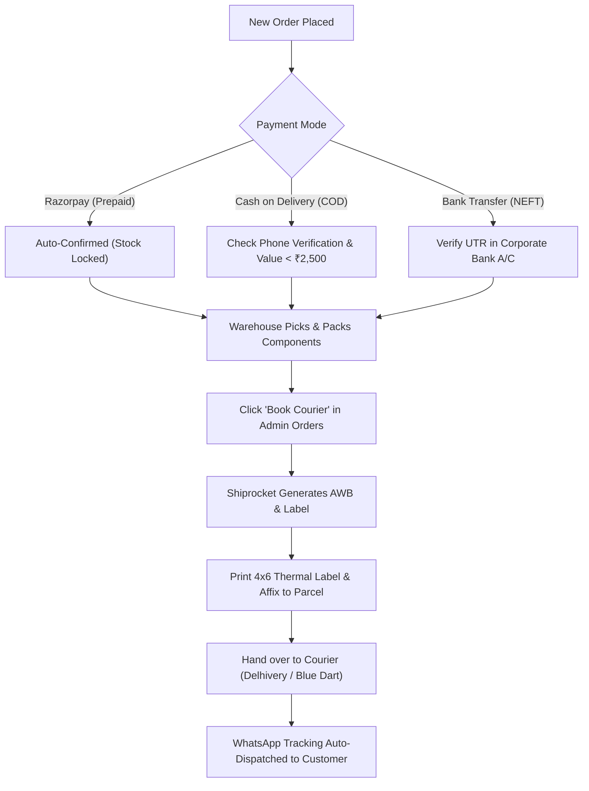

# Baba Electronics E-Commerce Platform — Operational Runbook

> **Target Audience:** Baba Electronics Operations Team, Warehouse Staff, & Sales Desk  
> **Platform Version:** 1.0.0 (Production Ready)  
> **Author:** Engineering Architecture Team  
> **Date:** November 2026  

---

## 1. Daily Operations Workflow Summary

---

## 2. Standard Operating Procedures (SOP)

### SOP 1: Order Processing & Shipping Label Printing
1. Navigate to **Admin Orders Hub** at `/admin/orders`.
2. Filter by status: `CONFIRMED`.
3. Verify line items, component pack sizes, and customer shipping address.
4. Click **"Book Courier"** next to the order:
   - System automatically requests Shiprocket for the lowest rate / fastest ETD carrier.
   - Unique **AWB Tracking Code** is assigned.
5. Click the generated AWB link to open the printable **4x6 Thermal Shipping Label**.
6. Print label, inspect barcode clarity, and stick to the bubble-wrapped parcel.
7. System automatically sends customer a WhatsApp notification with the live tracking URL.

---

### SOP 2: Reviewing Custom Build Requests & Issuing 15-Day Quotes
1. Navigate to **Custom Quotes Desk** at `/admin/quotes`.
2. Identify quote requests in `SUBMITTED` status.
3. Click **"Estimate"**:
   - Review customer-provided dimensions (e.g., 180 x 60 cm), LED pitch (P10/P5), and controller chip.
   - Download the client CAD / Gerber `.zip` archive to review board layers.
4. Enter:
   - **Total Quoted Cost (₹):** Full project fee.
   - **Lead Time (Days):** Realistic workshop manufacturing window (e.g., 10–14 days).
   - **Engineering Remarks:** Notes regarding SMPS power supply, IP65 weatherproofing, etc.
5. Click **"Issue Formal Quote"**:
   - Freezes price with a **15-Day Price Protection Guarantee**.
   - Client receives formal quote and can pay the **50% milestone advance** via Razorpay.
6. When 50% advance is captured, status automatically updates to `IN_PRODUCTION`.

---

### SOP 3: Monthly Accounting & Tally CSV Export
1. On the 1st of every calendar month, go to `/admin/orders`.
2. Click **"Export Tally Sales (CSV)"** in the top right header.
3. The downloaded CSV contains pre-formatted columns for Indian SME accounting:
   - *Voucher Date, Invoice Number, Party Name, GSTIN, Place of Supply, Sales Ledger (18%), Output CGST, Output SGST, Output IGST, Total Voucher Amount*.
4. Hand this CSV file directly to Baba Electronics' certified accountant for instant import into **Tally Prime / ERP 9**.

---

### SOP 4: Handling 7-Day Returns & Defect Replacements
1. If a verified customer reports a defective dev board or sensor within 7 days, check their claim in `/admin/orders`.
2. Verify:
   - Order delivery date was within the past 7 days.
   - Component is undamaged physically and has not suffered electrical overvoltage / reverse polarity.
3. Once approved, book reverse pickup directly through Shiprocket.
4. Upon receiving the return package, either dispatch a tested replacement or authorize a refund via the Razorpay merchant dashboard.

---

### SOP 5: Resolving 30-Minute Payment Failure Grace Period
* If a customer's online UPI / card payment drops during checkout, the platform **does not immediately release the stock**.
* The inventory remains reserved for **30 minutes**.
* The customer automatically receives an automated WhatsApp reminder with a direct payment resumption link.
* If unpaid after 30 minutes, the stock lock automatically dissolves back into the live catalog.

---

## 3. Production Launch Pre-Flight Checklist

Before switching DNS to live traffic, Baba Electronics management must verify:

- [x] **PostgreSQL Database:** Connected with Prisma schema migrations applied.
- [x] **Storefront Responsive UI:** Mobile-first navigation, search, and category taxonomy active.
- [x] **PWA Support:** Web App Manifest and offline fallback page operational.
- [x] **Razorpay Keys:** Replace test keys with Live Production Merchant Key ID & Secret.
- [x] **Shiprocket Credentials:** Set live production API email and registered warehouse pickup address.
- [x] **DLT & WhatsApp:** Ensure DLT Principal Entity and WhatsApp Cloud API templates are active.
- [x] **Concurrency & Race Conditions:** Verified passing under 50 simultaneous checkout attempts.
