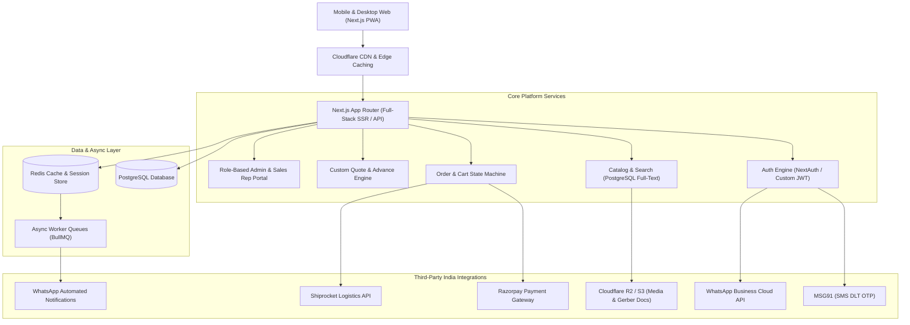
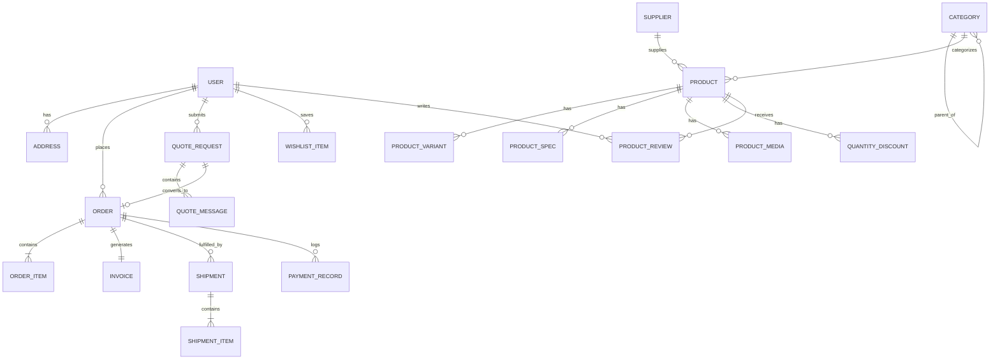
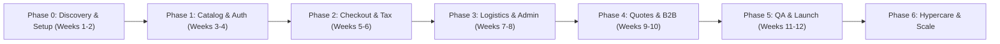
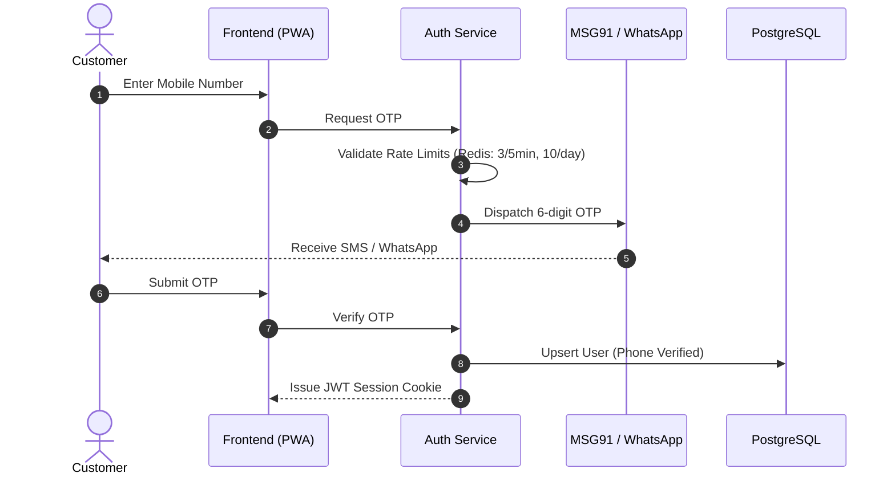
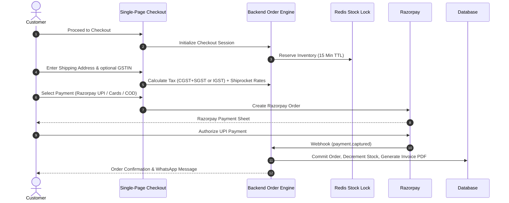
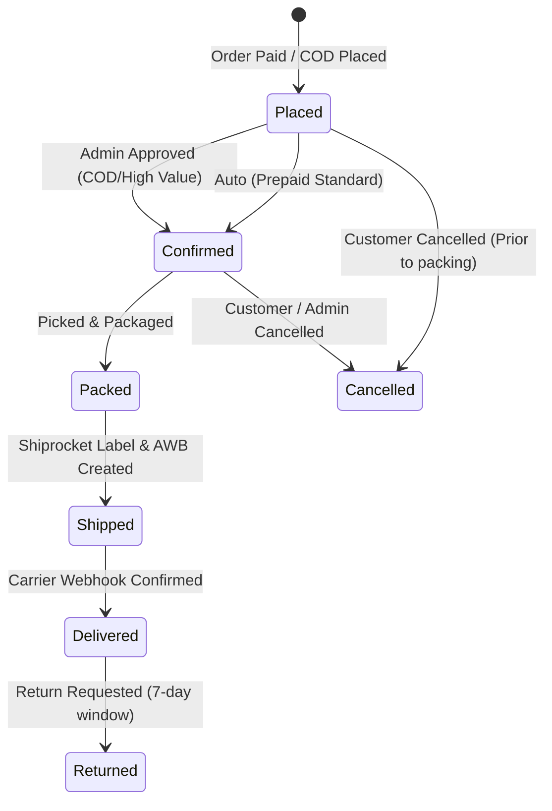
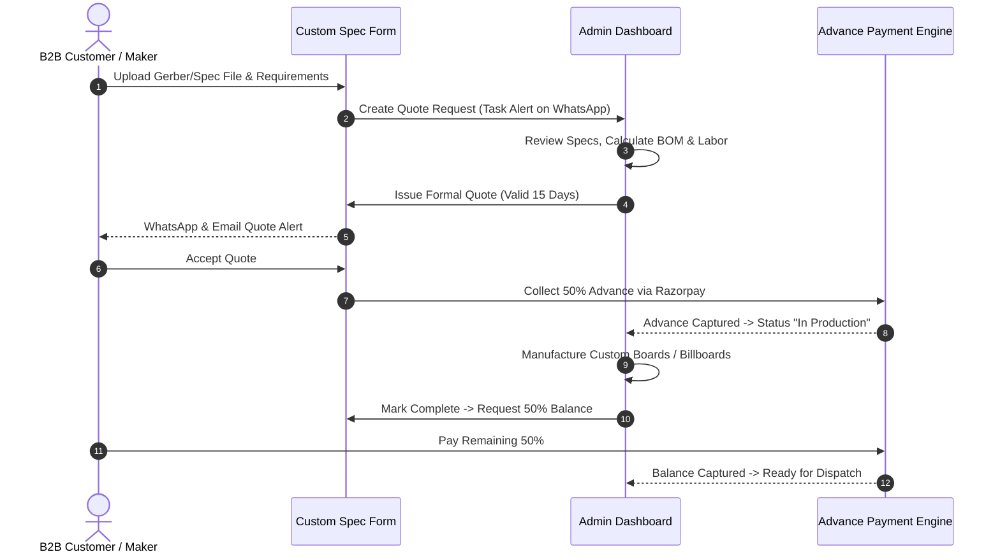

# Baba Electronics E-Commerce Platform — Master Implementation Plan

> **Client:** Baba Electronics (25+ Years in Business)  
> **Market:** India (INR, Domestic B2C & B2B)  
> **Prepared for:** @silver  
> **Date:** November 2026  
> **Version:** 1.0.0 — Production Roadmap  

---

## 1. Executive Summary & Project Context

Baba Electronics is transitioning from an established offline / directory-based sales model (JustDial, Kripko) to a modern, mobile-first unified digital commerce platform. 

The business encompasses a unique dual-model:
1. **Catalog Products (Ready Stock / Standard Traded & Manufactured):** IoT dev boards (ESP32, Arduino), sensors, switches, starter kits, and power modules with instant checkout, volume discount slabs, and automated courier fulfillment.
2. **Custom Engineering & Signage (Made-to-Order):** Logo sync boards, custom-built industrial boards, and commercial electronic billboards requiring technical spec/file submissions, bespoke quotation workflows, admin approvals, and milestone advance payments (50% advance / 50% dispatch).

### Key Architectural Tenets
* **Passwordless Authentication:** Zero password barrier. Pure Mobile OTP (SMS & WhatsApp via DLT-compliant gateway) + Google OAuth with forced mobile number binding.
* **Unified B2C & B2B Storefront:** Single catalog and transparent retail pricing with tiered quantity discounts (10+, 50+ slabs), B2B GSTIN self-registration, bulk variant ordering matrix, and sales rep proxy ordering ("Login-as-Customer").
* **India-First Operational Stack:** Razorpay (UPI, Netbanking, Cards), Cash on Delivery (COD) risk management, Shiprocket automated logistics & pincode serviceability, automated CGST/SGST/IGST tax calculation, and compliant PDF GST invoices.
* **Self-Contained Inventory Hub:** As Baba Electronics currently has no warehouse management system (WMS), the platform will act as the single source of truth for stock, kit/BOM component reservations, and manual production alerts.

---

## 2. Recommended Technology Architecture



### Core Stack Recommendations
| Layer | Recommended Choice | Rationale |
| :--- | :--- | :--- |
| **Frontend Framework** | **Next.js 15+ (App Router, React 19)** | Server Components for instant SEO/catalog loading, mobile-first responsive PWA, low bundle size. |
| **Styling & UI Components** | **Tailwind CSS + shadcn/ui + Lucide Icons** | High-polish, lightweight UI components built for fast iteration, accessible mobile touch targets. |
| **Database & ORM** | **PostgreSQL + Prisma / Drizzle ORM** | Relational integrity for orders, GST line-items, atomic stock reservations, and inventory audit logs. |
| **Cache & Async Queue** | **Redis + BullMQ** | 15-minute cart stock reservations, OTP rate limiting, WhatsApp notification dispatch, abandoned cart cron. |
| **Storage (Files/Datasheets)** | **Cloudflare R2 or AWS S3** | Zero-egress fee hosting for heavy technical datasheets, schematics, and customer Gerber file uploads. |
| **Payment Gateway** | **Razorpay India** | Industry standard in India; native UPI QR, intent flows, Netbanking, Cards, Webhook reconciliation. |
| **Logistics & Courier** | **Shiprocket API** | Multi-courier aggregator (Bluedart, Delhivery, DTDC, XpressBees), real-time pincode checks, automated label generation. |
| **SMS & WhatsApp Engine** | **MSG91 + Meta WhatsApp Cloud API** | Robust DLT template adherence for Indian SMS regulations, high-delivery WhatsApp OTP & status links. |

---

## 3. Data Architecture & Entity Relationship Blueprint



### Critical Database Schema Highlights
1. **User Identity & Auth:** `phone` (unique primary identifier, indexed, verified), `email` (optional/linked via Google OAuth), `role` (`CUSTOMER`, `SALES_REP`, `ADMIN`), `gstin`, `business_name`.
2. **Product, Sourcing & Inventory:** `sku` (unique), `source_type` (`MANUFACTURED` vs `TRADED`), `cost_price` (internal margin calculation), `vendor_id` (nullable FK to `suppliers`), `hsn_code`, `gst_rate` (5%, 12%, 18%, 28%), `stock_quantity`, `reserved_stock`, `low_stock_threshold`, `is_custom_build`, `requires_custom_freight`, `pack_size`, `technical_specs` (JSONB).
3. **Cart Stock Reservation & Recovery:** `cart_reservations` table with Redis TTL (15 minutes). Prevents stock overselling during flash purchases. Payment failure recovery token with 30-minute grace period.
4. **Custom Builds & Quotes:** `quote_requests` with `gerber_file_url`, `specs` (JSONB), `admin_quoted_amount`, `advance_amount_paid`, `status` (`SUBMITTED`, `ESTIMATED`, `CONVERTED`, `EXPIRED`).
5. **Multi-Shipment & Partial Delivery:** `shipments` linked to `orders`, containing `shipment_items` (item ID, quantity, AWB tracking, courier name, status `DISPATCHED` / `DELIVERED`).
6. **Reviews & Ratings:** `product_reviews` with `order_id` verification (verified buyer gate) and `moderation_status` (`PENDING`, `APPROVED`, `REJECTED`).

---

## 4. Phased Implementation Roadmap

The project is structured across **6 sequential phases** to maximize delivery velocity, minimize operational risks, and enable early user testing.



---

### Phase 0: Foundations, Discovery & Compliance Setup (Weeks 1 – 2)

#### Objectives
Establish all external accounts, regulatory compliance pipelines (DLT/GST), developer toolchains, and visual system design tokens.

#### Key Deliverables
* **DLT & SMS Onboarding:**
  - Guide client through Indian Telecommunications DLT registration (Jio / Airtel / Vodafone portal).
  - Register Principal Entity ID, Service Implicit Header (e.g., `BABAEL`), and SMS OTP templates.
  - Setup MSG91 or equivalent gateway account.
* **WhatsApp Cloud API Setup:**
  - Create Meta Business Manager account, register phone number for WhatsApp Business API.
  - Submit authentication (OTP) message templates and shipping update utility templates.
* **Google Cloud Console:**
  - Create GCP project, configure OAuth 2.0 consent screen, configure redirect URIs and verify domain.
* **Payment & Logistics Accounts:**
  - Razorpay merchant account activation, KYC verification, webhook secret generation.
  - Shiprocket courier account activation, pickup warehouse address registration.
* **Architecture & Repository Scaffolding:**
  - Initialize Next.js monorepo / application repository.
  - Configure PostgreSQL database schema migrations, Prisma/Drizzle setup, and CI/CD pipelines (GitHub Actions / Vercel).
  - Setup core UI design system (mobile-first layout, typography, breadcrumbs, drawer navigation).

#### Exit Criteria / Milestone Gate 0
* Client DLT Principal Entity approved.
* Razorpay Test Mode keys validated.
* Shiprocket API sandbox credentials active.
* Base Next.js + Tailwind + PostgreSQL development environment operational.

---

### Phase 1: Authentication & Product Catalog Engine (Weeks 3 – 4)



#### Objectives
Build the complete passwordless authentication layer and the comprehensive IoT product catalog with technical spec filtering, variant management, and datasheet media handling.

#### Key Deliverables
* **Passwordless Authentication Engine:**
  - Mobile OTP login via SMS and WhatsApp fallback.
  - 6-digit OTP generation, 5-minute expiry, Redis-backed rate limiter (3 resends, max 10 requests/day/IP).
  - Google OAuth login with mandatory phone number OTP verification prompt before first order.
  - Account unification: One customer profile per unique mobile number.
  - Admin login portal: Traditional Email + Password + 2FA code.
* **Catalog & Category Taxonomy:**
  - 2-tier category structure: `/category/sub-category` with auto-generated 301 redirects on slug changes.
  - Product URLs structured with SKU (e.g., `/product/esp32-wroom-32d-dev-board-BE-ESP32-001`).
  - Search & Faceted Filtering: Filter by technical specs (voltage, interface, chip, memory, pins), brand, and application.
* **Product Detail Page (PDP):**
  - Flexible multi-image gallery with pinch-to-zoom on mobile.
  - Public downloadable PDF datasheets & tutorial embed sections.
  - Variant selector (buttons/swatches for up to 3 attributes: memory, header pins, color).
  - Dynamic Stock Status: In Stock, Low Stock, or "Ships in X days" (Backorder).
  - Compare feature for up to 4 products side-by-side.
  - Verified Buyer Reviews & Moderation workflow (reviews only allowed from authenticated buyers who received the item; admin approval required prior to publishing).
* **Admin Catalog Portal v1:**
  - CRUD interface for Categories and Products.
  - Excel/CSV bulk import and export engine with downloadable sample template.
  - Review moderation dashboard (Approve / Reject customer feedback).

#### Exit Criteria / Milestone Gate 1
* Customer can sign in via OTP / Google OAuth with mobile verification.
* 200+ test SKUs imported via CSV with categories, specs, images, and datasheets.
* Faceted search filters products accurately by technical specs.

---

### Phase 2: Cart, Inventory, GST & Checkout Engine (Weeks 5 – 6)



#### Objectives
Implement real-time stock reservations, single-page mobile-first checkout, automated GST intra/inter-state calculations, Razorpay integration, and Cash on Delivery rules.

#### Key Deliverables
* **Cart & Stock Reservation System:**
  - Cart state persistence (local storage synced to database upon login).
  - 15-minute checkout stock reservation via Redis to avoid double-allocation.
  - Quantity discount slab calculation (10+, 50+ bulk price discounts applied automatically in cart).
  - Virtual starter kits: Dynamic stock validation derived from constituent component stock.
* **Single-Page Checkout:**
  - Address book management (Multiple shipping & billing addresses, GSTIN per billing address).
  - Pincode serviceability check with dynamic estimated delivery date (Shiprocket integration).
  - GSTIN capture with optional business entity name.
  - Delivery instructions / notes field.
* **Taxation Engine (India GST):**
  - Origin GST state comparison with customer delivery state.
  - Intra-State (Same State): Split equal CGST + SGST.
  - Inter-State (Different State): Full IGST.
  - Support for multiple GST rates per product (5%, 12%, 18%, 28%).
* **Payment Gateways, COD & Recovery:**
  - Razorpay standard checkout (UPI Apps, QR code, Debit/Credit Cards, Netbanking).
  - Webhook listener with HMAC signature verification for instant payment capture.
  - Cash on Delivery (COD) configuration: Configurable order ceiling, COD surcharge fee, and pincode restriction.
  - Bank Transfer (NEFT/RTGS) payment option for high-value business orders with UTR entry and admin verification.
  - Failed payment 30-minute recovery window: Order held in `PAYMENT_PENDING`, secure payment resumption link generated, and WhatsApp retry alert sent.
  - Oversized product logistics gate: Products marked with `requires_custom_freight` (such as commercial billboards) bypass courier checkout and trigger bespoke shipping quote reviews.
* **Automated GST Invoice Generation:**
  - Instant PDF invoice generation upon order confirmation.
  - Complies with Indian Tax Rules: Company GSTIN, HSN codes, SAC, sequential FY numbering (e.g., `BE-2026-27-000001`), digital signature, bank details, and payment verification QR code.

#### Exit Criteria / Milestone Gate 2
* Full end-to-end checkout with Razorpay test UPI/card payment.
* Stock locks for 15 minutes during checkout and releases if abandoned.
* PDF invoice generated with correct CGST/SGST vs IGST breakdown.

---

### Phase 3: Order Management, Logistics & Customer Portal (Weeks 7 – 8)



#### Objectives
Connect the fulfillment pipeline with Shiprocket, automate WhatsApp notifications, build the customer self-service account dashboard, and provide admin order dispatch controls.

#### Key Deliverables
* **Shiprocket Fulfillment Automation:**
  - Automatic push of confirmed orders to Shiprocket API.
  - Single-click courier assignment, shipping rate comparison, and AWB generation.
  - Shipping label, packing slip, and manifest printing directly from the Admin Panel.
  - Automated return pickup booking for approved return requests.
* **Order Lifecycle & Partial Shipments State Machine:**
  - Order statuses: `Placed`, `Confirmed`, `In Production` (Custom Builds), `Partially Shipped`, `Packed`, `Shipped`, `Delivered`, `Cancelled`, `Returned`.
  - Multi-shipment architecture: Support for splitting order fulfillment into separate consignments with individual Shiprocket AWBs and courier labels.
  - Self-serve cancellation allowed only while the order is in `Placed` or `Confirmed` status (prior to packing).
  - 7-day return request workflow for unused standard items with defective item replacement tracking.
* **Customer Account Dashboard & Quick Order:**
  - Passwordless persistent session with "Sign out of all devices" capability.
  - Order history with live Shiprocket tracking link and downloadable GST tax invoices.
  - Saved addresses with GSTIN numbers.
  - Quick Order suite: Reorder previous shipments, saved purchase lists, and direct "Order by SKU" batch input box.
* **Omnichannel WhatsApp & SMS Notifications:**
  - Real-time WhatsApp notifications: Order Confirmation with PDF link, Dispatch alert with AWB tracking link, Delivery confirmation.
  - Automated Abandoned Cart recovery: WhatsApp reminders sent at 1 hour and 24 hours post-abandonment.
* **Financial & Inventory Reconciliation:**
  - Razorpay settlement report reconciler against platform orders.
  - One-click Tally-compatible CSV export for monthly accounting.
  - Low stock dashboard alerts and automated WhatsApp warnings to store managers.

#### Exit Criteria / Milestone Gate 3
* Admin can click "Book Shipment" and immediately print a Shiprocket thermal shipping label.
* Webhook updates order to `Shipped` and triggers WhatsApp tracking notification.
* Abandoned cart cron job triggers automated recovery template to test number.

---

### Phase 4: Custom Build Quotes, B2B Matrix & Assisted Selling (Weeks 9 – 10)



#### Objectives
Implement the specialized custom engineering workflows for Baba Electronics' logo sync boards and electronic billboards, alongside B2B bulk matrix ordering and sales rep proxy ordering.

#### Key Deliverables
* **Custom Build & Billboard Request Engine:**
  - Interactive spec builder: Dimensions, board type, LEDs/switches, power specs, application details.
  - Secure file upload for CAD drawings, schematics, and Gerber archives (`.zip`).
  - Notification dispatch to Baba Electronics production team via WhatsApp upon submission.
* **Admin Quotation Management:**
  - Quote review dashboard: Admin enters price, notes, estimated lead time, and validity (default 15 days).
  - System generates formal downloadable Quotation PDF.
  - Conversion workflow: Customer clicks "Accept Quote" -> automatically converts into an order with milestone payment logic.
* **Milestone Payments (50% Advance / 50% Final):**
  - Custom build payment split: 50% advance to initiate manufacturing.
  - Status automatically moves to `In Production`.
  - Upon completion, system sends automated balance payment link for remaining 50% prior to dispatch.
* **B2B Bulk Variant Order Matrix & Sourcing Margin Controls:**
  - High-speed component order interface allowing wholesale buyers to enter quantities across multiple variants (e.g. 50x 4MB headers, 100x 8MB headers) on a single unified grid with one-click "Add All to Cart".
  - Traded goods & vendor tracking: Supplier registry, purchase cost tracking (hidden from storefront), and internal margin reporting categorized by manufactured vs traded items.
* **Sales Representative Assisted Selling ("Login-as-Customer"):**
  - Dedicated Sales Rep role in admin.
  - Secure proxy session: Sales rep can select a customer or create a new client account, configure their cart, apply approved quotes, and initiate the order on their behalf.
  - Audit logging of all sales-rep initiated transactions.

#### Exit Criteria / Milestone Gate 4
* User can submit a Gerber file, receive an admin-issued quote, pay 50% advance, and trigger production status.
* Wholesale matrix allows adding 10 variant combinations to cart simultaneously.
* Sales rep can place an order as a proxy user with verified audit records.

---

### Phase 5: QA, Security Hardening, UAT & Launch Readiness (Weeks 11 – 12)

#### Objectives
Execute rigorous quality assurance, stress testing, security audits, client staff training, and execute the production cutover.

#### Key Deliverables
* **Cross-Device & PWA Testing:**
  - Mobile responsiveness verification across iOS Safari and Android Chrome.
  - PWA installation audit (manifest, service worker for asset caching, offline fallback page).
  - Core Web Vitals audit (LCP < 2.5s, CLS < 0.1, FID/INP < 100ms).
* **Security & Anti-Abuse Hardening:**
  - OTP brute-force defense (Cloudflare Turnstile CAPTCHA on excessive attempts, strict Redis IP throttling).
  - File upload sanitization: Strict MIME-type checking, virus scan, and extension validation on Gerber/spec file uploads.
  - Role-Based Access Control (RBAC) validation: Ensuring sales reps cannot access master finance reports or system keys.
  - SQL injection and parameter tampering tests on order pricing and GST calculations.
* **Load & Concurrency Testing:**
  - Simulation of 10x traffic spikes (up to 200 concurrent checkout attempts) to verify Redis stock lock integrity without race conditions or negative inventory.
* **Client Staff Training & Operational Runbook:**
  - Hands-on training sessions with Baba Electronics staff:
    1. Managing products, categories, and inventory.
    2. Reviewing custom build requests and generating quotes.
    3. Processing daily orders, printing Shiprocket labels, and handing parcels to couriers.
    4. Handling returns and processing Razorpay refunds.
    5. Exporting monthly Tally sales reports.
* **Production Cutover & Domain Mapping:**
  - Point production domain (DNS setup with Cloudflare CDN, SSL certificate).
  - Switch Razorpay and Shiprocket from Sandbox/Test to Live Production API keys.
  - Final end-to-end live checkout verification with actual ₹1 payment and cancellation.

#### Exit Criteria / Milestone Gate 5
* Zero critical or high-severity security vulnerabilities.
* Client staff successfully processes a complete test order and prints shipping label independently.
* Production environment live with verified domain, SSL, and payment gateway.

---

### Phase 6: Post-Launch Hypercare, Growth & Phase 2 Roadmap (Post-Launch)

#### Objectives
Provide 30 days of intensive production hypercare, monitor platform performance, and roadmap secondary capabilities.

#### Key Deliverables
* **30-Day Hypercare Support:**
  - Daily review of payment settlement logs, webhook delivery rates, and failed OTP attempts.
  - Real-time exception tracking via Sentry / Datadog.
  - Rapid resolution of edge-case delivery or taxation discrepancies.
* **Analytics & Performance Tracking:**
  - Google Analytics 4 (GA4) with Enhanced Ecommerce events (View Item, Add to Cart, Begin Checkout, Purchase with INR amounts).
  - Heatmap tracking (Microsoft Clarity / PostHog) to optimize mobile checkout drop-offs.
* **Phase 2 Expansion Roadmap:**
  - **Company Accounts:** Multi-user business accounts (e.g. procurement officer creates PO, finance manager approves and pays).
  - **Automated GST Verification API:** Auto-filling company name and verified address directly from GSTIN via sandbox API.
  - **Native Mobile Apps (Android / iOS):** React Native / Flutter wrapper consuming the existing Next.js REST/GraphQL APIs.
  - **Serial Number Tracking:** Per-item hardware serial tracking for high-value boards and warranty verification.

---

## 5. Technical Specifications & Decision Matrix

| Dimension | Specification | Source / Rationale |
| :--- | :--- | :--- |
| **Authentication** | Mobile OTP (6 digits, 5-min expiry) + Google OAuth | Confirmed in Spec: No passwords for customers. Phone verification mandatory. |
| **OTP Channels** | SMS (MSG91) + WhatsApp Business API | Confirmed in Spec: Dual delivery for guaranteed Indian telecom delivery. |
| **Pricing Model** | Single public price for all buyers; Quantity slabs (10+, 50+) | Confirmed in Spec: No complex tier price lists; bulk slabs handle wholesale. |
| **Checkout Flow** | Single-page responsive checkout | Assumed: Optimized for mobile Indian buyers with minimal form friction. |
| **Stock Source of Truth** | Platform internal inventory database | Confirmed in Spec: Client has no existing warehouse software. |
| **Payment Gateway** | Razorpay (UPI, Cards, Netbanking) + COD | Confirmed in Spec: Domestic INR standard. |
| **Custom Build Advance** | 50% milestone advance, 50% pre-dispatch | Assumed: Mitigates financial risk for bespoke fabricated hardware. |
| **Logistics Carrier** | Shiprocket API (Pan-India) | Assumed: Automatic courier allocation (Bluedart, Delhivery, etc.). |
| **Oversized Billboards** | Excluded from automated courier; custom quoted | Confirmed in Spec: Large physical dimensions require dedicated freight. |
| **Accounting Integration** | CSV export formatted for Tally | Confirmed in Spec: Standard Indian SME accounting tool. |

---

## 6. Client Action Items & Prerequisites Checklist

To maintain the project timeline, the client must provide the following items:

```markdown
- [ ] 1. Google Cloud Platform (GCP)
  - [ ] Client creates Google Cloud Project
  - [ ] Configure OAuth Consent Screen (App Name, Logo, Support Email)
  - [ ] Add authorized redirect URIs
  - [ ] Provide Client ID & Client Secret

- [ ] 2. Indian Telecom DLT Registration
  - [ ] Register on DLT portal (e.g., VilPower, Jio, Airtel DLT) with Company PAN & GST
  - [ ] Obtain Principal Entity ID (PE ID)
  - [ ] Register Header / Sender ID (e.g., BABAEL)
  - [ ] Submit and approve Transactional / Service Implicit SMS OTP template

- [ ] 3. WhatsApp Business Cloud API
  - [ ] Meta Business Suite verification
  - [ ] Dedicated phone number for WhatsApp Business API
  - [ ] Submit Authentication template (OTP) & Utility template (Order status)

- [ ] 4. Payment Gateway (Razorpay)
  - [ ] Complete business KYC and activate account
  - [ ] Provide Live Key ID and Key Secret
  - [ ] Whitelist webhook endpoint URL

- [ ] 5. Logistics (Shiprocket)
  - [ ] Activate Shiprocket account and recharge shipping wallet
  - [ ] Configure pickup warehouse physical address and contact phone number
  - [ ] Provide Shiprocket API email & password / token

- [ ] 6. Master Business & Tax Information
  - [ ] Official Legal Entity Name & Registered Address
  - [ ] GSTIN certificate
  - [ ] HSN codes and applicable GST percentages for all product categories
  - [ ] Company Bank Account details for invoice printing (Bank Name, A/C No, IFSC, Branch)
  - [ ] High-resolution logo files and digital authorized signature image for PDF invoices
```

---

## 7. Risk Analysis & Mitigation Strategy

| Risk Event | Severity | Probability | Mitigation Strategy |
| :--- | :---: | :---: | :--- |
| **DLT SMS Template Delays** | High | Medium | Implement WhatsApp Business API authentication as the initial primary OTP channel while telecom DLT approvals are pending. |
| **High COD Return-to-Origin (RTO)** | High | High | Enforce mandatory OTP verification before order placement, set a maximum order limit for COD (e.g., ₹2,000), and add a nominal COD convenience charge. |
| **Inventory Overselling on High-Demand Components** | Medium | Medium | 15-minute atomic Redis reservation locks stock immediately when checkout starts. Stock auto-releases if payment fails. |
| **Custom Billboard Spec Misunderstandings** | Medium | Low | Mandatory spec intake form requiring dimensions, LED pitch, controller type, and file uploads. Production team verifies every quote manually. |
| **Shiprocket Pincode Non-Serviceability** | Low | Low | Real-time pincode validation on the Product Page and Checkout prevents users from placing orders to non-serviceable locations. |

---

## 8. Summary & Next Steps

This execution plan provides a rock-solid, production-grade roadmap tailored specifically to Baba Electronics' 25-year operational legacy and modern Indian e-commerce standards.

1. **Review & Approval:** Review this implementation plan and confirm the phase structure.
2. **Phase 0 Kickoff:** Initiate client onboarding for DLT, WhatsApp Cloud API, Razorpay, and Shiprocket credentials.
3. **Architecture Setup:** Initialize the codebase repository and database migrations as outlined in Phase 0.
